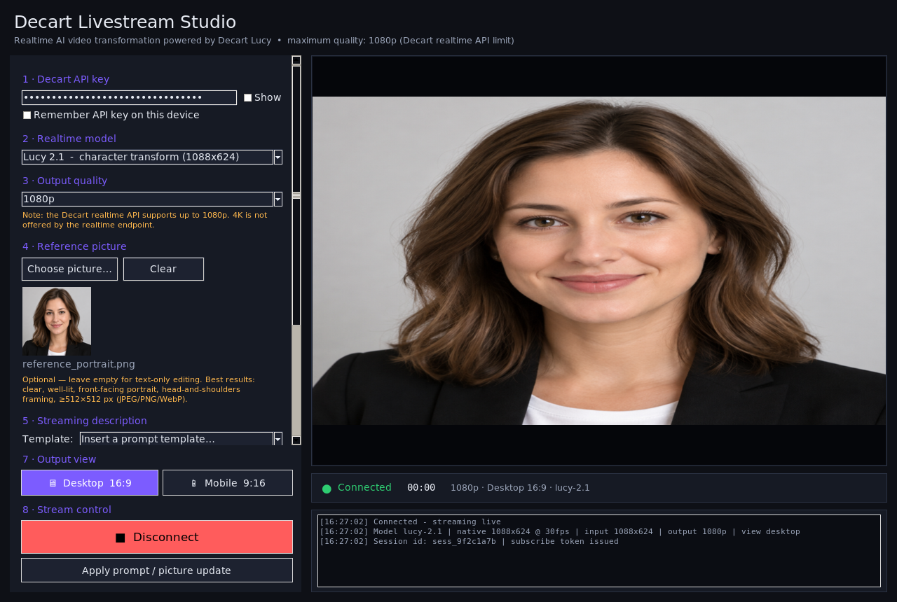

# Decart Livestream Studio

A Windows desktop application (Python + Tkinter) that starts and stops a **Decart Lucy realtime livestream** from a few simple inputs:

- 🖼️ **A reference picture** (the character/identity you want to become)
- 🔑 **Your Decart API key**
- 📝 **A streaming description** (the transformation prompt)
- 🖥️📱 **A Mobile / Desktop view toggle** that resizes the output stream (portrait 9:16 ⇄ landscape 16:9)
- ⏯️ **A single Connect / Disconnect button** that starts and ends the live stream

It is built directly on the official Decart Python SDK (`decart[realtime]`) and LiveKit WebRTC, following the [Lucy 2.1 Realtime documentation](https://docs.platform.decart.ai/models/realtime/lucy-2.1#python) and the [Python Realtime SDK reference](https://docs.platform.decart.ai/sdks/python-realtime).



*(The screenshot above shows the app connected and streaming a transformed preview.)*

> **⚡ Just want to run it?** See **[STARTUP.md](STARTUP.md)** for a 60-second
> quick-start (double-click `run.bat`), the manual commands, and startup
> troubleshooting.

---

## Table of contents

1. [What it does](#what-it-does)
2. [Quality & the "4K" note](#quality--the-4k-note)
3. [Requirements](#requirements)
4. [Quick start (Windows)](#quick-start-windows)
5. [Manual setup](#manual-setup)
6. [Using the app](#using-the-app)
7. [How it works (architecture)](#how-it-works-architecture)
8. [Building a standalone .exe](#building-a-standalone-exe)
9. [Project layout](#project-layout)
10. [Troubleshooting](#troubleshooting)
11. [API reference links](#api-reference-links)

---

## What it does

Decart's **Lucy** models are realtime video-editing models. You send a live video
stream in, and you get a transformed video stream back over WebRTC with very low
latency. Lucy 2.1 adds **character reference**: you upload a portrait and the
model maps your live motion, expressions and pose onto that identity in real
time.

This app wraps that entire flow in a friendly desktop UI:

1. You pick a **reference picture** (a portrait — a character, a celebrity, or a
   generated face).
2. You paste your **Decart API key**.
3. You type a **streaming description** (the prompt that tells Lucy what to do).
4. You choose the **video source** — your **webcam** (live camera) or the
   **reference picture itself** streamed as a static feed.
5. You pick **Desktop** or **Mobile** view. This changes the orientation of the
   stream that is sent to Decart, which in turn resizes the **output stream**
   (landscape 16:9 for desktop, portrait 9:16 for mobile).
6. You press **Connect & Start Stream**. The app captures your camera, pushes
   the frames to Decart, receives the transformed frames, and shows them live in
   the preview canvas. Pressing the same button again (now labelled
   **Disconnect**) ends the stream.

Everything is driven by the official SDK calls described in the Decart docs:
`DecartClient`, `models.realtime(...)`, `RealtimeClient.connect(...)`,
`RealtimeConnectOptions`, `ModelState`/`Prompt`, and the live `set()` state
update.

---

## Quality & the "4K" note

The request asked for **maximum 4K quality**. It is important to be precise about
what the Decart realtime API actually supports, because the app must be
"compatible" and honest:

> **The Decart realtime API currently caps output at 1080p.** The
> `RealtimeConnectOptions.resolution` field accepts exactly two values:
> `"720p"` (default) and `"1080p"`. There is **no 4K option** on the realtime
> endpoint.

Because of that, the app:

- **Defaults to `1080p`** — the highest quality the realtime API can deliver.
- Offers `720p` as a lighter-bandwidth alternative.
- Clearly labels the limitation in the UI and here, so nobody expects a 4K
  stream that the platform cannot produce.

In other words: the app runs the stream at the **maximum quality the Decart
realtime platform supports (1080p)**. If Decart later adds a higher resolution
tier, you only need to add the new value to `RESOLUTIONS` in `config.py` and it
will appear in the dropdown.

---

## Requirements

| Item | Requirement |
|------|-------------|
| OS | Windows 10 or Windows 11 (64-bit) |
| Python | **3.10 or newer** (the Decart SDK targets ≥ 3.10). The standard python.org installer includes Tkinter. |
| Webcam | Any DirectShow-compatible camera (only needed for the *Webcam* source) |
| Network | Outbound HTTPS + WebSocket access to `api.decart.ai` and `api3.decart.ai` |
| Decart account | An API key from <https://platform.decart.ai> (free credits on sign-up) |

Python packages (installed automatically by `run.bat`):

```
decart[realtime]   # Decart SDK + LiveKit WebRTC
opencv-python      # camera capture / frame conversion
numpy              # frame buffers
Pillow             # image handling + Tkinter preview
```

---

## Quick start (Windows)

1. **Install Python 3.10+** from <https://www.python.org/downloads/> and make
   sure **"Add python.exe to PATH"** is ticked during installation.
2. **Download / copy** the `decart_livestream_app` folder to your PC.
3. **Double-click `run.bat`.**
   - On first run it creates a local virtual environment (`.venv`), installs the
     dependencies, and launches the app. This can take a few minutes the first
     time.
   - Every later run starts in seconds.
4. In the app, paste your **Decart API key**, choose a **reference picture**,
   type a **streaming description**, pick **Desktop** or **Mobile**, and click
   **Connect & Start Stream**.

---

## Manual setup

If you prefer to run it by hand (or you are on macOS/Linux):

```bash
cd decart_livestream_app

# (optional) create an isolated environment
python -m venv .venv
# Windows:  .venv\Scripts\activate
# macOS/Linux:  source .venv/bin/activate

pip install -r requirements.txt
python app.py
```

> The camera index and the DSHOW backend used for fast camera opening are
> Windows-oriented, but the app also runs on macOS/Linux — the camera backend
> simply falls back to the platform default.

---

## Using the app

The window is split into a **control panel** on the left and the **live preview**
on the right.

### 1 · Decart API key
Paste the key you created at <https://platform.decart.ai>. Tick **Show** to
reveal it, and optionally tick **Remember API key on this device** to store it in
`%USERPROFILE%\.decart_livestream.json` (plain text — leave this off on shared
machines).

### 2 · Realtime model
Choose the model. The default is **Lucy 2.1** (character transform,
1088×624 @ 30 fps). Other options:

| Model | Native size | Notes |
|-------|-------------|-------|
| `lucy-2.1` | 1088×624 @ 30 fps | Character transform + text-only editing (default) |
| `lucy-2.5` | 1280×720 @ 30 fps | Flagship realtime; supports *fast mode* |
| `lucy-latest` | 1088×624 @ 30 fps | Always the newest realtime model |
| `lucy-restyle-2` | 1280×704 @ 30 fps | Style transfer |

> **Note on native size:** the Decart docs list Lucy 2.1 at 1280×720, while the
> installed SDK (`decart` 0.2.2) reports 1088×624. The app always reads the size
> from the installed SDK at runtime, so it sends exactly what the model expects.
> Output quality is controlled separately by the 720p/1080p setting.

### 3 · Output quality
`720p` or `1080p`. Default is **1080p** (see [the 4K note](#quality--the-4k-note)).

### 4 · Reference picture (optional)
Click **Choose picture…** and select a portrait. The reference image defines the
**character identity**; your live video supplies the **motion, expressions and
pose**, and Lucy 2.1 blends the two so the output looks like the reference
character performing your movements.

The picture is **optional** — leave it empty to use **text-only editing** (add,
replace, or restyle elements purely with a prompt; no reference needed).

Best results come from a clear, well-lit, front-facing, head-and-shoulders photo
of at least 512×512 px (JPEG, PNG or WebP). The app checks the format and size
when you pick a file and warns you if the image is smaller than recommended or
in an unsupported format. A thumbnail preview is shown.

> **Tip:** describe the picture in your streaming description. Lucy 2.1 matches
> the reference far more accurately when the prompt describes what is in the
> photo (skin tone, hair, clothing, distinctive features).

### 5 · Streaming description
This is the prompt sent to Lucy. The app seeds it with a good default:

> *"Substitute the character in the video with the person in the reference image."*

Use the **Template** dropdown to insert one of the four supported edit types
(from the official prompting guide), then fill in the blanks:

| Edit type | Prompt template |
|-----------|-----------------|
| Character transformation | *"Substitute the character in the video with &lt;description of the character in the reference image&gt;."* |
| Add | *"Add &lt;description of object in reference image&gt; to &lt;where to add it&gt;."* |
| Replace | *"Change &lt;object to change&gt; with &lt;description of the object in the reference image&gt;."* |
| Change attribute | *"Change &lt;object to change attribute of&gt; to &lt;description of new attribute&gt;."* |

**Prompt tips:** be specific; describe the reference image for character
transforms; keep to **one edit per prompt**; and tick **Auto-enhance prompt** to
let Decart expand short prompts (explicit detail always wins).

Examples:

- *Substitute the character with an older man, which has pale, wrinkled skin, light blue eyes, a powdered white wig with side curls, and wears a dark formal coat with a white ruffled neckpiece.*
- *Change the wall's color to light blue, natural consistent paint finish.*
- *Add a small dog running around in the background.*

You can change the prompt mid-stream with the **Apply prompt / picture update**
button — no reconnection required. This uses Decart's atomic `set()`, which
replaces the whole session state, so the app always sends the prompt, image and
enhance flag together to keep them in sync.

### 6 · Video source
- **Webcam (live camera)** — captures your camera and streams it to Decart. Set
  the **Camera index** (0 is usually the built-in webcam; try 1, 2… for
  external cameras).
- **Reference picture (static)** — streams the chosen picture itself as a static
  feed. This is handy for testing without a camera, or for driving a purely
  prompt-based transformation of an image.

### 7 · Output view
The **Desktop 16:9** / **Mobile 9:16** toggle resizes the output stream.

- **Desktop** sends landscape frames (`model.width × model.height`).
- **Mobile** sends portrait frames (`model.height × model.width` — width and
  height swapped, exactly as the Decart docs recommend for portrait mode).

Because the orientation is baked into the video track that Decart receives,
flipping the toggle **while connected** performs a quick, graceful reconnect so
the new orientation takes effect. While disconnected it simply sets the mode for
the next connection.

### 8 · Stream control
The big button toggles between **Connect & Start Stream** (green) and
**Disconnect** (red). The status bar shows the live connection state
(`connecting`, `connected`, `generating`, `reconnecting`, `disconnected`), an
elapsed timer, the active resolution/view/model, and the Decart session id. The
log panel shows a running trace, including the **viewer subscribe token** so
other clients can watch the session read-only.

---

## How it works (architecture)

The app is deliberately split into three small modules so the GUI stays
responsive and the networking stays testable.

```
app.py            →  Tkinter GUI (main thread)
decart_engine.py  →  asyncio + Decart SDK + LiveKit (worker thread)
config.py         →  constants (models, resolutions, colors, endpoints)
```

### Threading model

Tkinter must run on the main thread, while the Decart SDK is **async-only**. The
app therefore uses a two-thread design:

- **Main thread** — Tkinter event loop. It polls a thread-safe queue for status
  events and reads the latest decoded frame ~60 times per second.
- **Worker thread** — owns a private `asyncio` event loop that runs the entire
  Decart session (signalling, WebRTC, frame capture and consumption).

The GUI never blocks: calls such as `connect()`, `disconnect()` and
`update_state()` are thread-safe and simply schedule a coroutine on the worker
loop with `asyncio.run_coroutine_threadsafe`.

### The realtime pipeline

```
 webcam / picture
        │  (OpenCV, background thread)
        ▼
 RGB24 frames ──► livekit rtc.VideoSource ──► rtc.LocalVideoTrack
        │                                          │
        │                       RealtimeClient.connect(...)  (WebRTC)
        │                                          │
        ▼                                          ▼
  Decart Lucy model  ──transformed track──►  rtc.VideoStream
                                                   │
                                     frame.convert(RGB24) → PIL.Image
                                                   │
                                                   ▼
                                        Tkinter preview canvas
```

Key implementation details:

- **Input frames** are produced by a grabber (`WebcamGrabber` reads the camera on
  its own thread; `PictureGrabber` re-emits a cached resized image). Frames are
  center-cropped to the target aspect ratio and resized to the model size so the
  stream is never distorted.
- **Frame push** happens inside the async loop at exactly `model.fps`, using
  `rtc.VideoFrame(width, height, type=rtc.VideoBufferType.RGB24, data=...)`.
- **Output frames** arrive via the `on_remote_stream` callback. Each frame is
  converted with `frame.convert(rtc.VideoBufferType.RGB24)` and wrapped in a
  `PIL.Image`. There is a pure-Python I420 fallback in case `convert()` is
  unavailable.
- **Latency control** — only the *latest* frame is kept (old frames are dropped
  instead of queued), so the preview never drifts behind the live stream.
- **Lifecycle** — `initial_state` (prompt + reference image) is passed to
  `connect()` so the very first generated frame is already transformed, avoiding
  the brief raw-camera flash the docs warn about. On disconnect the app calls
  `realtime.disconnect()` and closes the LiveKit source so the room (and billing)
  stops immediately.

### Connection lifecycle

The engine mirrors the SDK's states and forwards them to the UI:

| State | Meaning |
|-------|---------|
| `connecting` | Initial connection in progress |
| `connected` | Connected, ready to send prompts |
| `generating` | Actively producing transformed video |
| `reconnecting` | Connection lost; SDK retrying with backoff |
| `disconnected` | Idle, or after `disconnect()` |

---

## Building a standalone .exe

To produce a self-contained Windows executable (no Python needed on the target
machine):

```bat
build_windows.bat
```

This installs PyInstaller into the local `.venv` and bundles the Decart SDK,
LiveKit (including its native WebRTC library) and OpenCV. The result is:

```
dist\DecartLivestreamStudio\DecartLivestreamStudio.exe
```

The build script uses `--collect-all` for `decart`, `livekit` and `cv2` so the
native libraries and data files are included. The first build takes a few
minutes; later builds are faster.

---

## Project layout

```
decart_livestream_app/
├── app.py               # Tkinter GUI + application logic
├── decart_engine.py     # async Decart/LiveKit engine + frame grabbers
├── config.py            # models, resolutions, palette, endpoints
├── requirements.txt     # Python dependencies
├── run.bat              # one-click Windows launcher (venv + install + run)
├── build_windows.bat    # PyInstaller build script
├── README.md            # this file
├── app_preview.png      # screenshot of the running app
├── assets/
│   ├── app.ico          # window / exe icon
│   └── app_icon.png     # PNG copy of the icon
├── sample_images/       # example reference picture + sample output
└── tests/
    ├── test_headless.py      # builds the GUI + exercises the frame pipeline
    └── test_engine_paths.py  # validates LiveKit frame push + Decart options
```

Run the tests (Linux/macOS need a virtual display, e.g. `xvfb-run`):

```bash
xvfb-run -a python tests/test_headless.py
python tests/test_engine_paths.py
```

---

## Troubleshooting

**"Missing dependencies" dialog on start**
Run `pip install -r requirements.txt` (or just use `run.bat`).

**`InvalidAPIKeyError` in the log**
The API key is wrong, expired, or has no credits. Create a fresh key at
<https://platform.decart.ai/api-keys>.

**Black preview / "Could not open camera index 0"**
Another app may be using the camera, or the index is wrong. Close other camera
apps and try index 1 or 2. You can also switch the source to *Reference picture
(static)* to confirm the pipeline works without a camera.

**Stream is slow / choppy**
Switch the output quality to `720p`, close bandwidth-heavy apps, and prefer a
wired connection. WebRTC is sensitive to packet loss.

**`WebRTCError` / `reconnecting` loops**
Usually a firewall or VPN blocking WebSocket/ICE traffic. Allow the app through
the Windows firewall and try disabling the VPN. The SDK auto-retries with
exponential backoff (up to 5 attempts) before giving up.

**The exe crashes on launch after building**
Make sure you built with the provided `build_windows.bat` (the `--collect-all`
flags matter for LiveKit's native library). Rebuild with `--clean`.

---

## API reference links

- Lucy 2.1 Realtime — <https://docs.platform.decart.ai/models/realtime/lucy-2.1#python>
- Python SDK overview — <https://docs.platform.decart.ai/sdks/python>
- Python Realtime API — <https://docs.platform.decart.ai/sdks/python-realtime>
- Client tokens — <https://docs.platform.decart.ai/getting-started/client-tokens>
- Pricing — <https://docs.platform.decart.ai/getting-started/pricing>
- SDK source (GitHub) — <https://github.com/DecartAI/decart-python>
- Get an API key — <https://platform.decart.ai>

---

*Built on the Decart Python SDK (`decart[realtime]`) and LiveKit. Lucy, Decart
and the Decart logo are trademarks of Decart AI.*
